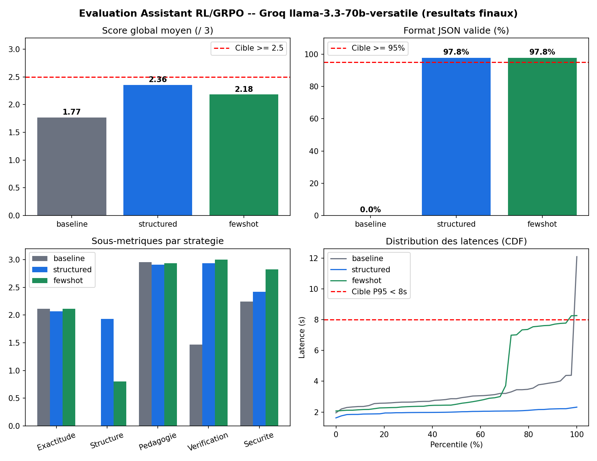

# Assistant de raisonnement avancé : évaluation de stratégies de prompting d'un LLM

Projet E3, ESIEE Paris (2025-2026), encadré par Badr Tajini.

Le projet mesure comment la manière de questionner un LLM change la qualité et la forme de ses réponses. On pose les mêmes 45 questions pédagogiques (Python et algorithmique de base) à **Llama 3.3 70B** via l'API Groq, avec trois stratégies de prompt, et on note chaque réponse automatiquement.



## Résultats

45 questions × 3 stratégies = 135 réponses notées (notebook `notebooks/s7_defense.ipynb`).

| Métrique | Baseline | Structuré | Few-shot | Cible |
|---|---:|---:|---:|---:|
| Score global (/3) | 1,58 | 2,10 | 2,05 | ≥ 2,5 |
| Réponses JSON valides | 0 % | 97,8 % | 100 % | ≥ 95 % |
| Latence P95 | 2,69 s | 1,17 s | 1,43 s | < 8 s |

- Imposer un contrat de sortie JSON dans le prompt système fait passer les réponses exploitables de 0 % à près de 100 %, et réduit la latence.
- Le score de fond reste sous la cible de 2,5 : le format est maîtrisé, la qualité du raisonnement beaucoup moins.
- Le catalogue contient aussi des cas de robustesse : injection de prompt, question hors périmètre, question ambiguë. L'injection de prompt est la catégorie la plus faible en baseline (0,50/3) et remonte à 1,75/3 avec un prompt structuré.

## Méthode

1. **Catalogue** : 45 questions avec réponse de référence, concepts attendus et piège identifié, séparées en `dev` et `test` (`data/eval/test_catalog.jsonl`). Les questions `test` ne servent jamais à régler les prompts.
2. **Trois stratégies** (`app/prompts.py`) :
   - `baseline` : question brute, réponse libre ;
   - `structured` : prompt système qui impose un JSON à 5 champs (`reformulation`, `reasoning_steps`, `example`, `verification`, `limitations`) ;
   - `fewshot` : même contrat, avec un exemple de réponse attendue.
3. **Notation automatique** (`app/assistant_core.py`) : validité du JSON, présence des concepts attendus, présence d'un exemple et d'une vérification. Tous les résultats sont journalisés en CSV (`results/`).
4. **Suite prévue** : un jeu de 43 exemples pour un fine-tuning SFT-LoRA (`results/sft_dataset.jsonl`) et 5 fonctions de récompense pour un entraînement GRPO (`notebooks/s6_grpo.ipynb`). Les récompenses sont calculées sur les vraies réponses ; l'entraînement complet n'a pas été lancé.

## Contenu du dépôt

| Dossier | Contenu |
|---|---|
| `notebooks/` | Un notebook par semaine : baseline (S2), contrat de prompts (S3), benchmark (S4), SFT-LoRA (S5), GRPO (S6), bilan (S7) |
| `app/` | Prompts, appel au modèle, notation, démo Gradio et tableau de bord Streamlit |
| `data/eval/` | Catalogue de questions et grille de notation |
| `results/` | Rapports, CSV de toutes les réponses, graphiques |
| `demo/` | Démo déployable sur Hugging Face Spaces |
| `docs/rapport_final.pdf` | Rapport final du projet |

## Lancer le projet

```bash
pip install -r requirements.txt

# Vérification complète sans clé d'API (cible déterministe locale)
make smoke

# Évaluation réelle avec le modèle
export GROQ_API_KEY="ta_cle"
make eval

# Démo web
make gradio
```

La clé d'API se lit uniquement depuis la variable d'environnement `GROQ_API_KEY` (ou un fichier `.groq_key` local, ignoré par Git). Aucune clé n'est versionnée dans ce dépôt.

L'intégration continue (`.github/workflows/smoke.yml`) relance `make smoke` à chaque push : syntaxe, tests unitaires et pipeline d'évaluation complet.

## Limites

- Le domaine évalué est Python débutant. Le titre du projet mentionne la cybersécurité, un cadrage initial abandonné en cours de projet (voir la section 12 du rapport final).
- La notation est heuristique (mots-clés et structure) : elle mesure bien le format, moins bien la justesse fine du raisonnement.
- Un seul modèle a été testé ; les résultats ne se généralisent pas tels quels à d'autres LLM.

## Équipe et crédits

Projet d'équipe : Elias Brahimi, Abdelrahmane Shanan, Anis Nouari, Jasser Ben Mabrouk, Ahmed Seggane, Qassim Mechri.

Le squelette du dépôt (structure, cible déterministe, scripts d'évaluation, licence MIT) provient du kit de démarrage fourni par Badr Tajini pour le cours. Les notebooks, prompts, résultats, la démo et le rapport sont le travail de l'équipe.
